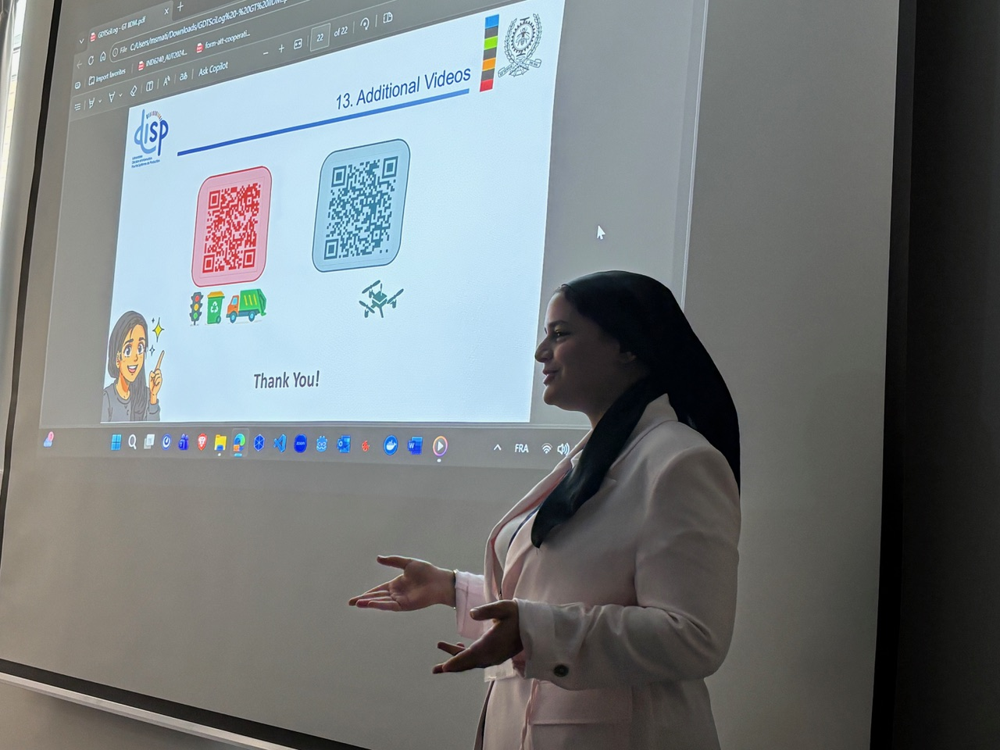
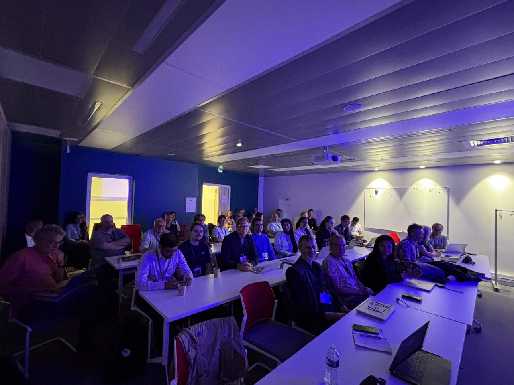

La session du GT IIDM s'est tenue le 3 juin 2026, de 11 h à 12 h 30, dans le cadre des Journées nationales « 1er Congrès des Sciences du Logiciel » à Polytech Lille, Villeneuve-d’Ascq.

## Programme

- 11 h - 11 h 25, Nicolas Anquetil : « Meta-models for reverse engineering in practice »
- 11 h 25 - 11 h 50, Meriem Smati : « DTGen : une approche de génération pour l’ingénierie et l’orchestration de jumeaux numériques dans les systèmes de systèmes »
- 11 h 50 - 12 h 15, Hugo Richard : « Weaving executable models and code for software development »
- 12 h 15 - 12 h 30 : discussion générale sur le GT IIDM

La session s'est déroulée en présentiel et a accueilli 40 personnes.

## Quelques photos

